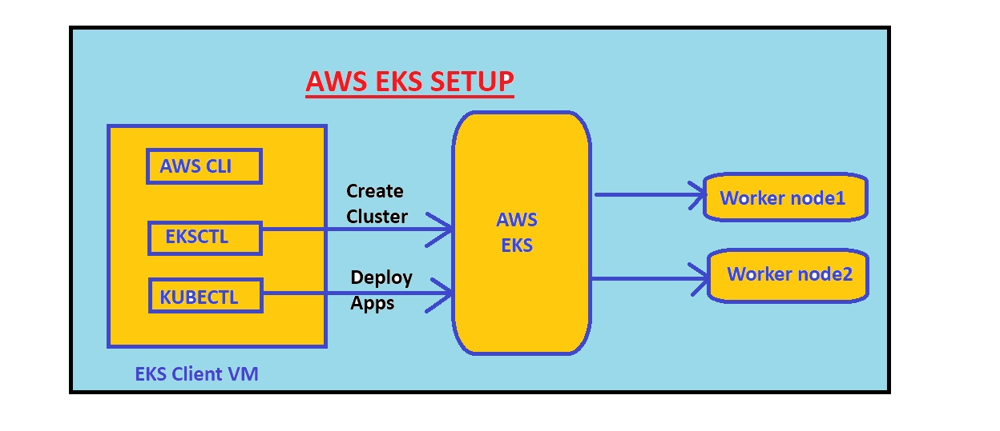

# EKS Cluster Setup

## Architecture


## Step 1: Create the EKS management host
Launch an Ubuntu EC2 instance (Mumbai, ap-south-1) and connect to it.

### Install kubectl
```bash
curl -LO "https://dl.k8s.io/release/$(curl -L -s https://dl.k8s.io/release/stable.txt)/bin/linux/amd64/kubectl"
sudo install -o root -g root -m 0755 kubectl /usr/local/bin/kubectl
kubectl version --client
```

### Install AWS CLI
```bash
sudo apt update
sudo apt install unzip -y
curl "https://awscli.amazonaws.com/awscli-exe-linux-x86_64.zip" -o "awscliv2.zip"
unzip awscliv2.zip
sudo ./aws/install
aws --version
```

### Install eksctl
```bash
curl -sL "https://github.com/eksctl-io/eksctl/releases/latest/download/eksctl_Linux_amd64.tar.gz" | tar xz -C /tmp
sudo mv /tmp/eksctl /usr/local/bin
eksctl version
```

## Step 2: Create an IAM role and attach it to the host
1. IAM → Roles → Create role → AWS service → EC2.
2. Attach `AdministratorAccess` (lab only, never production).
3. EC2 → select the instance → Actions → Security → Modify IAM role.
4. Verify: `aws sts get-caller-identity`

## Step 3: Create the cluster
```bash
eksctl create cluster --name venkat-eks --region ap-south-1 \
  --zones ap-south-1a,ap-south-1b \
  --node-type c7i-flex.large --nodes 2
```
Takes about 15-20 minutes. Then verify:
```bash
kubectl get nodes
```

## Step 4: Deploy an app
Apply a Deployment and a LoadBalancer Service, then open the load balancer hostname in a browser.
```bash
kubectl apply -f app.yaml
kubectl get deploy,pods,svc
```

## Troubleshooting: node group stuck
- **Problem:** the node group stack timed out after 25 minutes with `t3.medium`.
- **Cause:** my account is on the Free Plan, which only allows free-tier-eligible instance types.
- **Fix:** switched to `c7i-flex.large`, and the node group was ready in about 3 minutes.

## Cleanup
```bash
kubectl delete -f app.yaml
eksctl delete cluster --name venkat-eks --region ap-south-1
```